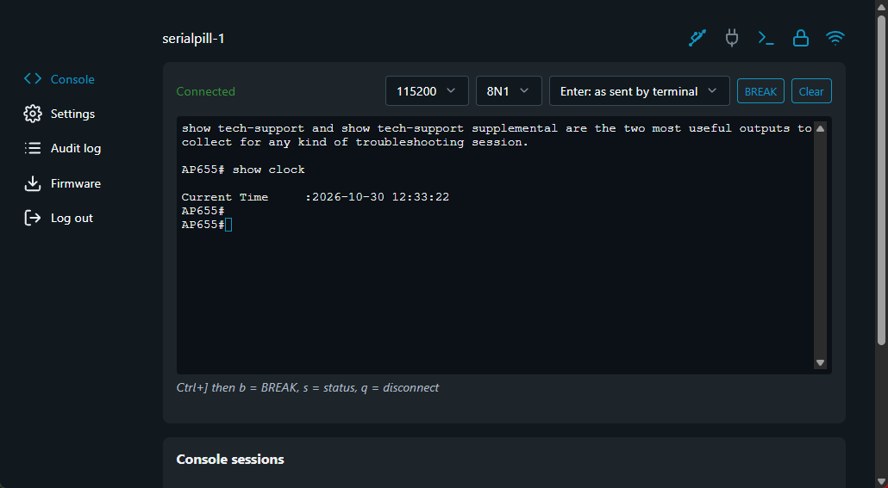

# SerialPill – wireless console server firmware for The Pill by Shelly

Custom firmware for **The Pill by Shelly** (ESP32-C3, 8 MB) that turns it into a wireless
3.3 V UART console cable: **SSH**, **telnet** (off by default), web terminal over
**HTTP** or **HTTPS**, and **USB-C as a COM port**. The default wiring fits the **Aruba APs** console
ports. The firmware installs through the stock Shelly web UI ("Update from file") and can put the
official Shelly firmware back by itself. Bluetooth is not used and stays disabled.



## Wiring (Pill micro-USB "I/O" socket)

The original UART pinout of The Pill is compatible with standard micro-USB serial consoles, using the
same pin mapping as the AP-CBL-SERU (JY728A) cable (Settings → Serial port shows it as a drawing).


| Pill micro-USB pin | Function (default) | 
|---|---|
| 1 (VCC, red) | NC **output** (cut the wire if possible) |
| 2 (D−, white) | GPIO4 = **TX** |
| 3 (D+, green) | GPIO3 = **RX** |
| 4 (OTG ID) | GPIO6 – unused  |
| 5 (GND) | GND |

A straight micro-USB cable (white↔white, green↔green, black↔black, **red cut**) is the right
for the Aruba AP-6xx APs. **TX/RX Swap Crossover** in the settings (Serial port, or `serial.swap`) for devices
that need it, or to connect two Pills with a straight cable. Default baudrate setting: 9600 8N1.
Never plug the Pill's micro-USB socket into a PC or charger.

## Install (from stock Shelly firmware ≥ 2.0)

1. Build or take `dist/SerialPill-<ver>-shelly-ota.zip`.
2. Shelly web UI → Settings → Firmware → **Update from file** → choose the zip
   (or `python tools/shelly_ota.py <ip> dist/SerialPill-<ver>-shelly-ota.zip`).
3. On its first boot SerialPill replaces the Shelly bootloader with a standard ESP-IDF bootloader
   built for the identical partition table, writes standard `otadata`, **takes over the Shelly WiFi
   settings** (client mode) and invalidates the Shelly image in the other slot (so a rollback can
   never boot-loop into it). The `shelly` factory partition is never touched.
4. Open `http://<ip>/` and **create the administrator** – the setup page also asks whether HTTP
   should redirect to HTTPS and whether telnet is enabled (both unchecked by default). *Skip*
   leaves the web UI open without a password (a warning is shown until a password is set under
   Settings → Authentication); SSH/telnet logins stay refused until then. If Shelly authentication
   was enabled, its admin password is imported and works directly.

If something fails before step 3 completes, the Shelly bootloader rolls back to stock Shelly by
itself. USB-C recovery always works (`esptool`, see *Backups*).

Without imported WiFi the device starts its **WPA2 access point** (see *WiFi* below) at
`http://192.168.33.1/`.

### Install over USB-C (development)

```powershell
# build and flash with the isolated PlatformIO core used by tools\build.ps1
$env:PLATFORMIO_CORE_DIR = "$env:USERPROFILE\.serialpill-pio"
& "$env:USERPROFILE\.serialpill-venv\Scripts\python.exe" -m platformio run -e pill -t upload --upload-port COM8
```

`flash-com8.bat` does the same for a Pill on `COM8` and writes the output to `flash-com8.log`.
A USB install keeps the Shelly filesystems (`fs_0`/`fs_1`); if they still hold a Shelly WiFi
configuration, it is imported on first boot and the device starts in client mode, otherwise in
access-point mode.

## WiFi

| Mode | Behaviour |
|---|---|
| **Access point** (factory default) | WPA2-PSK network `SerialPill-XXXXXX` (last three MAC bytes), password **`serialpill`**, device address **`192.168.33.1/24`**, DHCP for clients from `192.168.33.2`. SSID and password (8–63 characters) can be changed under Network. |
| **Client** | Joins the configured network (DHCP or static IPv4), reachable as `<hostname>.local` (mDNS). The access point is **not** opened on WiFi outages; hold the PCB button for 10 s (factory reset) to get it back. |

Switch between the modes under Settings → Network (`network.wifi_mode` = `ap` / `sta`). WiFi changes
take effect after a reboot. When installed from stock Shelly, its WiFi client settings are imported
and the device starts in client mode.

The factory access-point password is the same on every device: change it before using the
access point outside a lab.

## Access

| Service | Default | Notes |
|---|---|---|
| SSH | on, port 22 | RSA-2048 host key generated on first power-on and kept (fingerprint on the Status page). Password (local or TACACS+) and public keys (ed25519, ecdsa-nistp256/384/521, rsa-sha2-256). `ssh-copy-id user@device` works. KEX curve25519/ecdh-nistp/dh-group14-sha256, AES-GCM/CTR, HMAC-SHA2. |
| Telnet | **off**, port 23 | Same login as SSH; clear text – trusted networks only. |
| Web UI / API | HTTP 80, HTTPS 443 | HTTPS works out of the box with a self-signed ECDSA P-256 certificate created on first boot (SAN: hostname, hostname.local, IP); upload your own under Settings → TLS configuration. HTTP → HTTPS redirect optional (off by default). |
| USB-C | COM port | Transparent bridge, no login (physical access). Can be switched off (Serial tab); then USB-C carries the log. |

In every console session **Ctrl+]** opens a menu: `b` = send BREAK, `s` = status, `q` = disconnect,
`Ctrl+]` = send a literal ^]. `ssh user@device status` / `ssh user@device break` work as commands.

### Line endings

| Setting (`serial.…`) | Values | Effect |
|---|---|---|
| `enter` | `raw` (default), `cr`, `crlf`, `lf` | `raw` passes client input unchanged (needed for binary transfers such as XMODEM). The other modes turn any Enter from a client – CR, CR LF, CR NUL or a bare LF – into exactly one CR, CR LF or LF; a CR LF from the client never becomes two Enters. |
| `out_crlf` | `false` (default) / `true` | Device output: a bare LF becomes CR LF in interactive sessions (fixes "staircase" output of devices that send only LF); existing CR LF is not doubled. The HTTP API history always stays raw. |

Telnet follows RFC 854: a client's CR LF and CR NUL both mean CR, so in `raw` mode a telnet Enter
reaches the device as CR. The web console always echoes typed characters locally; SSH and telnet
sessions echo them too (`access.echo`, on by default – the Enter key shows as a new line, Backspace
erases). Turn echo off for devices that echo themselves and for binary transfers (XMODEM).

### Login banner

`access.banner` (Settings → Login banner, up to 511 characters of plain text) is shown before the
login on SSH (SSH banner message), telnet and the web login page. Default: *SerialPill console
server - authorized access only. All connections are logged.* Empty = no banner.

### Web UI

Settings are grouped like the stock UI: component (serial port), network, access (SSH, telnet,
web access, login banner), users (local, TACACS+) and device settings – device name, reboot,
factory reset, location and time (time zone as POSIX TZ string, NTP server), authentication,
firmware, debug (remote syslog, audit log, device information) and TLS configuration.

Styled like the stock Pill web UI (same dark palette, icon rail, settings list with detail pages)
on [Blades CSS](https://blades.dev/) 3.0.0 (MIT, successor of Pico CSS, which the stock UI uses),
embedded in the firmware together with xterm.js – no internet access needed. Centered on desktop,
responsive on tablets and phones (bottom tab bar, one-column forms).
In `raw` mode all byte values pass in both directions except Ctrl+] (0x1d, the menu key) – send
Ctrl+] twice for a literal 0x1d.
Up to 6 console sessions share the UART (output to all, input from all); new sessions are refused
cleanly when memory runs low.

## Firmware management

- **SerialPill update**: Firmware tab → drop or browse `dist/SerialPill-<ver>-ota.bin` → Update from file
  (`spctl.py <ip> firmware <file>`), or paste an http(s) link → Update from link. Only SerialPill
  images for the ESP32-C3 are accepted.
- **Restore official Shelly**: Firmware tab → Check for updates → Restore (stable or beta) (TLS to
  `updates.shelly.cloud` verified against the embedded Shelly/Allterco root CA; the package SHA-256
  is checked against the server index), upload the official `Pill-x.y.z.zip` or give its link. Every part is
  verified (SHA-256 from the manifest) before the boot regions are written; SerialPill moves itself
  to slot `app_1` first if needed (one automatic reboot). The current WiFi client settings are
  written into the Shelly configuration, so the restored Shelly stays on the network. SerialPill
  settings are erased.

Note: stock Shelly firmware already records a package signature check (`sig_check_result`) without
enforcing it. A future Shelly release may refuse unsigned packages; installing would then need
USB-C (`esptool`).

## REST API (selection)

All endpoints need a session cookie (`POST /api/login`) or HTTP Basic auth.

| Request | Purpose |
|---|---|
| `GET /api/info` | device, version, initialised (no auth) |
| `POST /api/login`, `POST /api/logout`, `GET /api/whoami` | web session |
| `POST /api/setup` | create the first administrator |
| `GET /api/status` | WiFi, serial, sessions, memory, SSH fingerprint |
| `GET/POST /api/config` | settings (partial JSON, e.g. `{"serial":{"baud":115200,"swap":true}}`) |
| `GET/POST/DELETE /api/users`, `POST/DELETE /api/keys` | users and SSH keys |
| `GET /api/term?since=N`, `POST /api/term` | console over HTTP (`?break=1` sends BREAK) |
| `GET /api/ws` | console over WebSocket |
| `POST /api/tls`, `DELETE /api/tls` | HTTPS certificate (PEM cert + key) |
| `POST /api/firmware` | SerialPill update (raw body) |
| `POST /api/firmware/url` | update from a link `{"url": ...}` (SerialPill `.bin` or Shelly `.zip`) |
| `GET /api/shelly/check`, `POST /api/shelly/restore?channel=stable`, `POST /api/shelly/upload` | Shelly restore |
| `GET /api/wifi/scan` | visible networks |
| `GET /api/log`, `POST /api/reboot`, `POST /api/factory-reset` | system |

`tools/spctl.py` is a small command line client for all of this.

## Building

Windows, PowerShell (ESP-IDF refuses MSYS/Git Bash):

```powershell
powershell -ExecutionPolicy Bypass -File tools\build.ps1
```

Uses PlatformIO 6.1.18 + pioarduino (ESP-IDF 5.5.1) in an isolated core (`~/.serialpill-pio`),
wolfSSL 5.8.2 / wolfSSH 1.4.20 from the ESP component registry. `tools/patch_wolfssl.py` runs
from `CMakeLists.txt` on every configure: it enables RSA/ed25519 for ESP32-C3 in the wolfSSL
template and fixes two wolfSSH bugs (empty `pty-req` modes from paramiko/Netmiko clients).
Environments: `pill` (release) and `pill-debug` (logs stay on USB-C, COM bridge off by default).
`tools/mkpkg.py` builds the Shelly OTA package from `shelly-fw/Pill-2.0.1.zip` (official package,
not part of the repository) and the app image.

Bluetooth is disabled in `sdkconfig.defaults` (`CONFIG_BT_ENABLED=n`).

Files: `main/` firmware (`bridge.c` UART hub, `ssh_server.c`, `telnet_server.c`, `usb_bridge.c`,
`web.c`/`api.c`/`web/index.html`, `users.c`, `tacacs.c`, `ota.c`, `migrate.c`), `partitions.csv`
(identical to the stock layout), `main/bootloader/bootloader-std.bin` (standard bootloader written
during migration), `main/shelly_ca.pem` (Shelly update server CAs), `tools/spctl.py` (command line
client), `test/newline_matrix.py` (hardware test; reads credentials from `test/.credentials`, which
is git-ignored).

Not in the repository (git-ignored): `backup/` (flash dumps with WiFi credentials and device
keys), `shelly-fw/` (official Shelly packages), `test/.credentials`, build output (`.pio/`,
`dist/`, `managed_components/`, generated `sdkconfig.*`).

## Backups and USB recovery

`backup/` (not in git) can hold full 8 MB dumps of both Shelly Pills taken before any change. 
Restore over USB-C:

```bash
python -m esptool --port COM9 write-flash 0 backup/shellypill-<MAC>-fw2.0.1-full.bin
```

Take a dump of your own device first (`python -m esptool --port COMx read-flash 0 0x800000 backup/<name>.bin`).

## Third-party components

xterm.js (MIT, `main/web/xterm-LICENSE.txt`), Blades CSS (MIT, `main/web/blades-LICENSE.md`),
wolfSSL (GPLv3 or commercial) and wolfSSH (GPLv2 or later, or commercial) from the ESP component
registry, ESP-IDF and mDNS (Apache-2.0), esp_littlefs (MIT). Because wolfSSL is GPL-licensed, a
published firmware binary has to be distributed under GPL-compatible terms.
